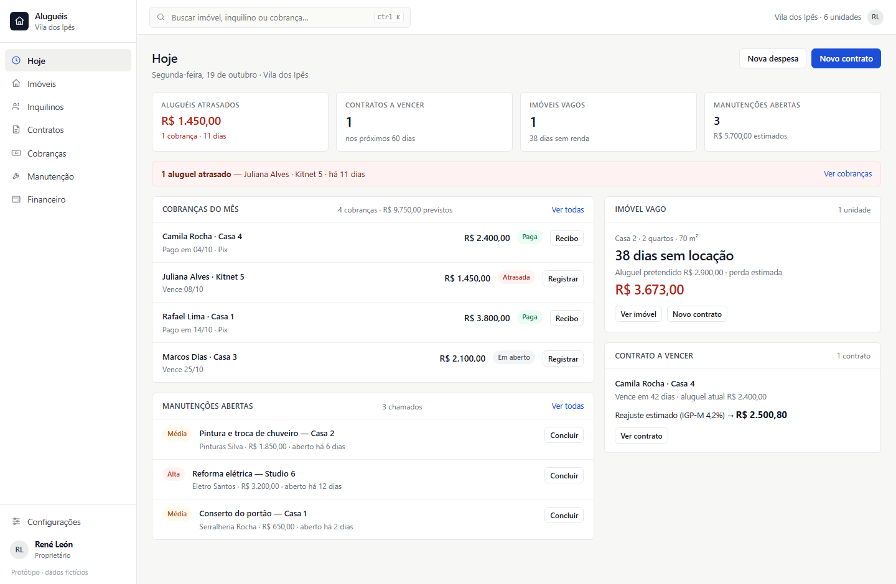

# Aluguéis — protótipo visual

Protótipo **estático** de um ERP para quem aluga imóveis por conta própria.
Todas as unidades ficam no **mesmo endereço** (uma vila/terreno com várias casas,
kitnet e studio), como no caso de quem constrói e aluga no próprio lote.

Sem backend, sem build e sem dependências externas: um único `index.html` que abre
com duplo clique.



**Demonstração online:** https://reneleonreguero.github.io/erpalugueis/

## Que dores o protótipo resolve

| Dor do dia a dia | Como aparece no protótipo |
|---|---|
| Aluguel atrasado sem controle de multa e juros | Tela **Cobranças** destaca o atraso e a baixa calcula **multa de 2%** + **juros de 0,0333% por dia** |
| Não saber quanto o imóvel vago está custando | Tela **Hoje** mostra os dias sem locação e a **perda estimada** (dias/30 × aluguel pretendido) |
| Contrato vencendo e reajuste esquecido | Alerta de contrato a vencer em 60 dias com reajuste estimado (IGP-M/IPCA) e renovação em um clique |
| Várias casas no mesmo terreno, cada uma com uma situação | Tela **Imóveis** lista as unidades do mesmo endereço, com inquilino, aluguel e contrato |
| Manutenção solta, sem saber o custo | Tela **Manutenção** com prioridade, fornecedor e custo; ao concluir, vira **despesa** da unidade |
| Caixa do mês obscuro | Tela **Financeiro** com recebido, a receber, despesas e saldo, filtrando por unidade |
| Documento e histórico perdidos | Cada unidade tem abas de **Contrato, Cobranças, Despesas, Manutenção e Documentos** |

## Telas

1. **Hoje** — atrasos, contratos a vencer, vacância, manutenções e cobranças do mês.
2. **Imóveis** — todas as unidades do mesmo endereço, com filtro por status.
3. **Unidade** — contrato, cobranças, despesas, manutenção e documentos da casa.
4. **Inquilinos** — quem está em dia, quem está atrasado e quem já saiu.
5. **Contratos** — vigência, aluguel, índice, garantia e status (vigente, a vencer, encerrado).
6. **Cobranças** — navegação por mês, previsto/recebido/em aberto/atrasado e baixa de pagamento.
7. **Manutenção** — chamados abertos, em andamento e concluídos.
8. **Financeiro** — lançamentos do mês com saldo e filtro por unidade.

## Interações funcionais

- Navegação lateral e links diretos por hash (`#cobrancas`, `#unidade/u2`).
- Busca global com `Ctrl K` / `⌘ K` (Enter leva para a lista de imóveis).
- **Registrar pagamento** com multa e juros calculados por dia de atraso.
- **Nova despesa**, **nova manutenção** e **concluir manutenção** (gera a despesa).
- **Novo contrato**, **renovar** (com reajuste) e **encerrar** (a unidade entra na vacância).
- **Nova unidade** e **novo inquilino**, sempre no mesmo endereço.
- Navegação por mês em Cobranças e Financeiro.
- Todos os dados são fictícios e ficam em memória: ao recarregar, tudo volta ao estado inicial.

## Regras representadas

- Competência (mês do aluguel) separada do vencimento.
- Multa de 2% e juros de 0,0333% ao dia sobre o aluguel em atraso.
- Valor pago editável (permite representar pagamento parcial).
- Reajuste anual por IGP-M ou IPCA com aviso a partir de 60 dias.
- Custo da vacância = dias vagos ÷ 30 × aluguel pretendido.
- Manutenção concluída entra automaticamente como despesa da unidade.
- Recibos numerados em sequência ao registrar o pagamento.

## Como abrir

```text
Duplo clique em index.html
```

Ou arraste o arquivo para o navegador. Não precisa instalar nada.

## Publicar no GitHub Pages

```bash
git init
git add index.html preview.png README.md
git commit -m "Protótipo visual de gestão de aluguéis"
git branch -M main
git remote add origin https://github.com/SEU-USUARIO/SEU-REPO.git
git push -u origin main
```

Depois: **Settings → Pages → Source: Deploy from a branch → main / (root) → Save**.
A URL fica no formato `https://SEU-USUARIO.github.io/SEU-REPO/`.

## Estrutura

```text
index.html    protótipo completo (HTML + CSS + JS)
preview.png   captura da tela Hoje
README.md     este arquivo
```

## Limites deste protótipo

- Não há backend, autenticação, banco de dados nem upload real.
- Datas são calculadas a partir do dia em que o arquivo é aberto.
- Emissão de boleto, assinatura de contrato e integrações são apenas representadas na interface.
- O objetivo é validar o visual e o fluxo antes de qualquer implementação.
